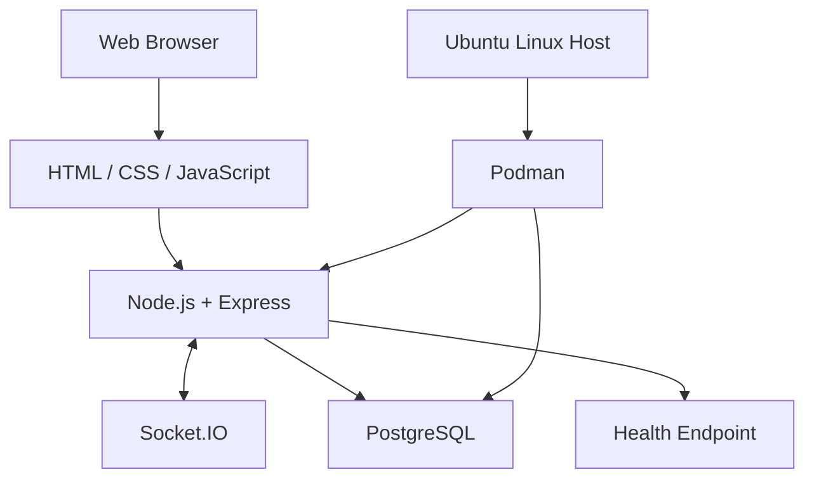

# CloudChat | Real-Time Messaging Infrastructure

**A containerised real-time messaging application deployed on Ubuntu Linux using Podman, Node.js, Socket.IO, and PostgreSQL.**

[](https://nodejs.org/)
[](https://www.postgresql.org/)
[](https://socket.io/)
[](https://podman.io/)
[](https://ubuntu.com/)

---

## Overview

CloudChat is a self-hosted messaging application developed to explore real-time application architecture, database persistence, containerisation, and Linux service operations.

The project brings together a Node.js application, Socket.IO communication, and PostgreSQL storage in a containerised environment running on an Ubuntu home server.

Beyond application development, the project provides a practical environment for learning service health monitoring, container networking, configuration management, and deployment troubleshooting.

## Architecture



### Core Components

| Component | Responsibility |
|---|---|
| Web client | User interface and browser-side interaction |
| Node.js and Express | Application server and HTTP endpoints |
| Socket.IO | Real-time communication |
| PostgreSQL | Relational data storage |
| Podman | Container execution and networking |
| Ubuntu Linux | Host operating system and service environment |

## Engineering Highlights

- **Real-time application design** — integrating browser-side events with a Socket.IO server.
- **Database integration** — connecting the application to PostgreSQL.
- **Containerised deployment** — running application services with Podman.
- **Linux operations** — deploying and managing services on an Ubuntu home server.
- **Health monitoring** — exposing `/api/health` for application and database status checks.
- **Configuration management** — separating database connection settings from application source code.
- **Version control** — maintaining the project in Git and GitHub.

## Technology Stack

| Layer | Technology |
|---|---|
| Application runtime | Node.js |
| HTTP server | Express |
| Real-time transport | Socket.IO |
| Database | PostgreSQL |
| Frontend | HTML, CSS, JavaScript |
| Container engine | Podman |
| Operating system | Ubuntu Linux |
| Source control | Git, GitHub |

## Deployment Environment

The application has been deployed to a self-managed Ubuntu Linux server.

| Setting | Configuration |
|---|---|
| Application container | `cloudchat` |
| Database container | `cloudchat-postgres` |
| Container networking | `cloudchat-network` |
| Host application port | `3001` |
| Application health endpoint | `/api/health` |
| Container management | Podman with user-level systemd integration |

The database is configured as a separate service from the application, allowing the components to communicate over a container network.

> **Security note:** The current LAN deployment is intended for development and learning. Public internet exposure requires appropriate authentication, HTTPS, access controls, backups, and security testing.

## Health Verification

CloudChat provides a health endpoint for operational checks.

```bash
curl http://127.0.0.1:3001/api/health
```

The endpoint has returned a healthy application status with a connected database in the development environment.

## Local Development

### Prerequisites

- Node.js and npm
- PostgreSQL
- Git

### 1. Clone the repository

```bash
git clone https://github.com/sathwik-svg/cloudchat.git
cd cloudchat
```

### 2. Install dependencies

```bash
npm install
```

### 3. Configure the database

Set the database connection environment variable expected by the application. Keep credentials in a local environment file or another secure configuration mechanism.

Never commit passwords, database credentials, or production environment files.

### 4. Start the application

Check the scripts defined in `package.json`, then run the appropriate start command. If `start` is configured:

```bash
npm start
```

## Reliability and Security Roadmap

The next development milestones focus on making the application easier to test, operate, and maintain.

- [ ] Automated unit and integration tests
- [ ] Continuous integration using GitHub Actions
- [ ] Structured application logging
- [ ] Authentication and authorisation
- [ ] Request validation and rate limiting
- [ ] HTTPS through a reverse proxy
- [ ] Database backup and restore testing
- [ ] Resource limits and container security hardening
- [ ] Operational metrics and alerting
- [ ] Documented deployment and recovery procedures

## Project Scope

CloudChat is a practical engineering project, not a claim of production readiness. Its purpose is to develop and demonstrate skills in application integration, container operations, Linux deployment, and reliability-oriented engineering.

## About the Developer

**Computer Science and Engineering Student | Cloud & DevOps Engineering**

I am a B.Tech Computer Science and Engineering student at Vasireddy Venkatadri Institute of Technology (VVIT), India, with a strong interest in cloud infrastructure, DevOps, automation, and site reliability engineering.

I build hands-on projects to strengthen my understanding of Linux systems, containerised applications, infrastructure operations, and software delivery.

My long-term career goal is to grow into a Cloud Solutions Architect role, developing the engineering fundamentals required to design secure, scalable, and reliable systems.

### Connect

- **GitHub:** [sathwik-svg](https://github.com/sathwik-svg)
- **Portfolio:** [Cloud & DevOps Portfolio](https://portfolio-wuht.onrender.com)
- **LinkedIn:** [Professional Profile](https://www.linkedin.com/in/sathwik-ganji-a80b143b5)

---

*Designed and deployed as a hands-on exploration of real-time software, containerisation, and Linux-based service operations.*
